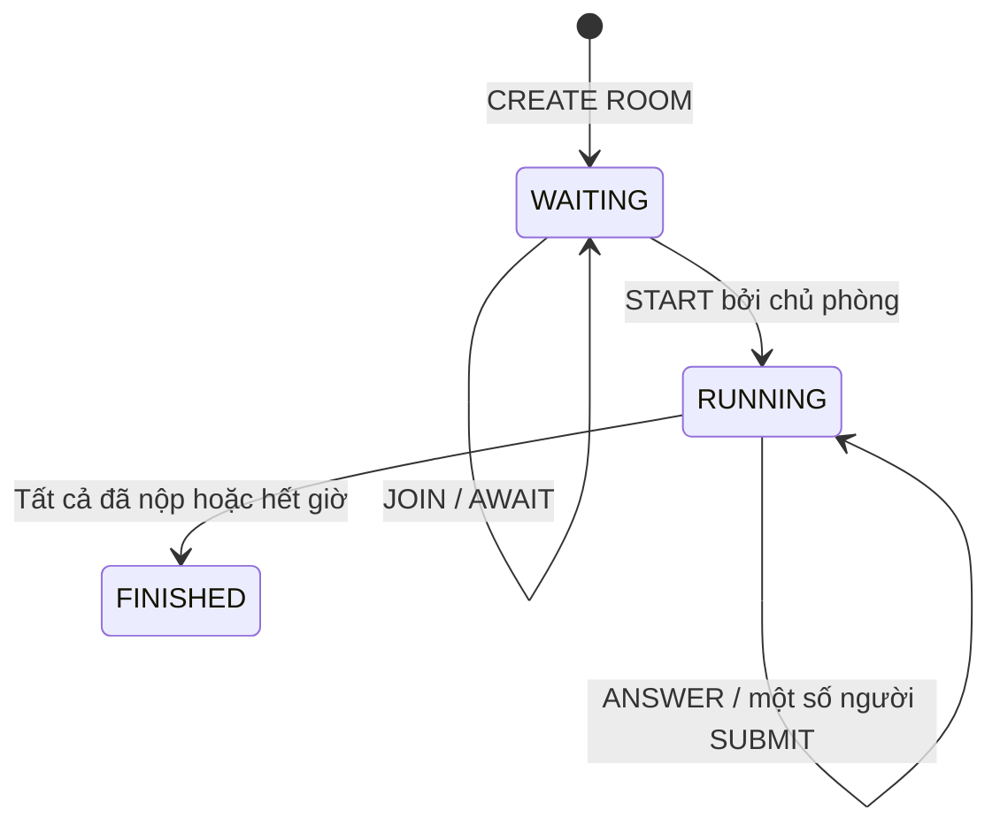
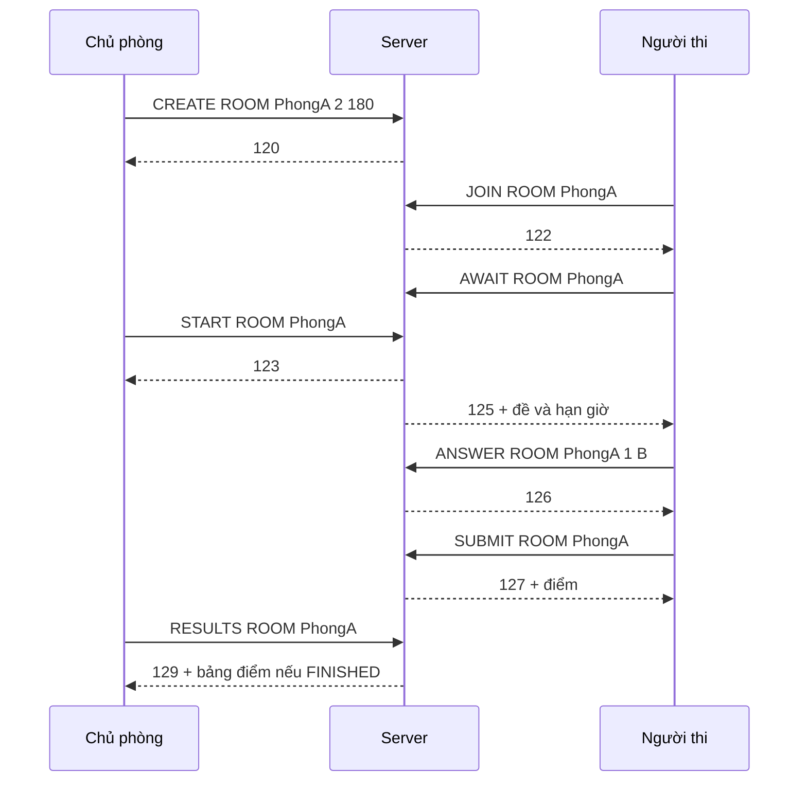

# Đặc tả giao thức văn bản — Online Test System

Tài liệu này mô tả thông điệp thực tế trên mạng của phiên bản hiện tại. `session.md` giải thích toàn bộ tiến trình vận hành; tài liệu này tập trung vào request, response, sự kiện và mã lỗi. Hai chế độ thi và luyện tập dùng chung tên hành động; phạm vi `ROOM` hoặc `PRACTICE` xác định đối tượng và quy tắc xử lý.

## 1. Vận chuyển và ranh giới thông điệp

- Client và server kết nối qua TCP/IPv4, mặc định cổng 9000.
- Nội dung ứng dụng là chuỗi UTF-8. TCP vẫn vận chuyển byte và không tự giữ ranh giới thông điệp.
- Mỗi request, response hoặc sự kiện là **một dòng kết thúc CRLF**, tức hai byte `0D 0A` (`\r\n`). Không gửi nguyên bốn ký tự gạch chéo/r/gạch chéo/n.
- Không có header độ dài 4 byte như thiết kế ban đầu.
- Dòng nội dung trên mạng tối đa 65.536 byte, chưa tính CRLF; độ dài tính theo byte UTF-8, không theo số chữ hiển thị.
- Một lần recv có thể chỉ nhận một phần dòng; bên nhận đọc tiếp đến CRLF. Nhiều dòng trong một lần gửi vẫn là nhiều thông điệp độc lập.
- Thiếu CRLF thì bên nhận tiếp tục chờ. Dòng quá dài, NUL, LF đơn hoặc CR không có LF tiếp theo làm đóng kết nối; không bảo đảm có mã lỗi gửi lại.

Các khối ví dụ sau viết `\r\n` để minh họa dấu kết thúc. Khi thao tác menu, client tự thêm hai byte CRLF; người dùng không gõ lệnh giao thức trực tiếp vào menu.

## 2. Quy ước trường và dữ liệu

### 2.1. Dấu cách và dấu ngoặc kép

Tên hành động/phạm vi dùng chữ HOA. Các trường cách nhau bằng đúng một dấu cách. Tham số có thể đặt trong ngoặc kép; chuỗi chứa dấu cách cần được đặt trong ngoặc kép. Trường rỗng viết `""`. Dùng `\"` cho dấu ngoặc kép và `\\` cho dấu gạch chéo ngược.

```text
CREATE ROOM "Phong hoc 1" 2 180\r\n
JOIN ROOM "Phong hoc 1"\r\n
```

Client chuẩn thường đặt tham số trong ngoặc kép ngay cả khi không có khoảng trắng. Ví dụ `JOIN ROOM "PhongA"` và `JOIN ROOM PhongA` cùng được hiểu là một yêu cầu. Server đặt dữ liệu phản hồi trong ngoặc kép; mã số, lý do lỗi và từ khóa cấu trúc không có ngoặc kép.

Dữ liệu người dùng không chứa `|`, CR, LF, NUL hoặc ký tự điều khiển. Tầng nhập liệu chưa xác minh UTF-8 hợp lệ. Bộ codec hiện nhận một số escape theo cơ chế nội bộ; không dùng escape xuống dòng để đưa dữ liệu nhiều dòng vào tham số yêu cầu.

### 2.2. Các tham số

| Tham số | Ý nghĩa / giới hạn |
|---|---|
| username | Tên tài khoản, không rỗng, tối đa 32 byte, duy nhất trong database |
| password | Mật khẩu đăng ký không rỗng, tối đa 128 byte; client cũng kiểm tra giới hạn khi nhập đăng nhập |
| room_name | Tên phòng do người tạo nhập, tối đa 48 byte; không phải username hoặc topic |
| practice_id | ID bài luyện tập do server cấp; khi gửi phải là số nguyên từ 1 đến 1.000.000.000 |
| count | Số câu, từ 1 đến 50 và không vượt số câu hiện có trong ngân hàng |
| duration | Thời lượng theo giây, từ 10 đến 86.400 |
| pos | Vị trí câu bắt đầu từ 1, phải nằm trong bài; khác với ID câu hỏi trong ngân hàng |
| choice | Một ký tự A, B, C hoặc D |
| end_at | Unix timestamp theo giây do server đặt; không phải số giây còn lại |
| correct / total | Số câu đúng / tổng số câu; trường correct trong phản hồi điểm không phải ký tự đáp án đúng |
| selected | Lựa chọn chính người thi đã lưu, hoặc chuỗi rỗng |
| automatic | 0: nộp sớm; 1: server tự nộp khi hết giờ |

Ngân hàng mẫu có 20 câu. Chọn 30 câu vẫn nằm trong giới hạn thiết kế 1–50 nhưng không đủ ngân hàng, nên trả `409 NOT_ENOUGH_QUESTIONS`. Không lặp lại câu để bù số lượng.

## 3. Request — yêu cầu từ client

### 3.1. Cấu trúc

```text
ACTION [SCOPE] [PARAMETERS...]\r\n
```

- ACTION là hành động, ví dụ CREATE, ANSWER hoặc SUBMIT.
- SCOPE xác định đối tượng: ROOM, PRACTICE; LIST dùng ROOMS vì hỏi danh sách phòng.
- Thông tin tài khoản hiện tại lấy từ phiên gắn với socket, không gửi lại user_id hoặc token trong mỗi yêu cầu.
- Trên một kết nối, client gửi một yêu cầu, chờ phản hồi chính rồi mới gửi yêu cầu tiếp theo. Không có request ID.

### 3.2. Tài khoản

| Request | Server thực hiện | Response thành công |
|---|---|---|
| REGISTER username password | Kiểm tra, băm mật khẩu và lưu tài khoản; không tự đăng nhập | 110 |
| LOGIN username password | Xác minh mật khẩu, kiểm tra phiên trùng và xác thực kết nối | 111 |
| LOGOUT | Xóa phiên đăng nhập nhưng giữ kết nối TCP | 112 |

Project đã bỏ admin/student trong giao thức và giao diện, không có mã đăng ký admin. Bất kỳ tài khoản nào cũng có thể tạo phòng. Cột users.role chỉ được giữ để tương thích database cũ, không dùng phân quyền. Không còn yêu cầu thêm câu hỏi hoặc đổi mật khẩu.

### 3.3. Hành động cho thi và luyện tập

| Request | Điều kiện và tác dụng | Response thành công |
|---|---|---|
| CREATE ROOM room_name count duration | Tên phòng chưa tồn tại; đủ câu. Chọn cố định đề, tạo WAITING, chưa tính giờ | 120 |
| CREATE PRACTICE count duration | Đủ câu. Tạo bài cá nhân, chọn cố định đề, bắt đầu tính giờ ngay | 131 practice_id end_at count |
| LIST ROOMS | Đã đăng nhập. Lấy tối đa 100 phòng mới nhất | 121 và các bản ghi phòng |
| JOIN ROOM room_name | Phòng WAITING, chưa đủ 32 người. JOIN lại khi đã là thành viên vẫn thành công | 122 |
| START ROOM room_name | Chỉ chủ phòng; phòng WAITING, có ít nhất một người đã JOIN | 123 |
| AWAIT ROOM room_name | Chỉ thành viên. Giữ yêu cầu chờ khoảng tối đa 30 giây | 124 / 125 / 130 |
| QUESTIONS ROOM room_name | Chỉ thành viên. Hỏi ngay, không giữ chờ như AWAIT; khi RUNNING trả toàn bộ đề | 124 / 125 / 130 |
| QUESTIONS PRACTICE practice_id pos | Chủ bài, còn giờ và chưa chấm. Lấy một câu | 132 pos text A B C D |
| ANSWER ROOM room_name pos choice | Thành viên, RUNNING, còn giờ và chưa nộp. Lưu hoặc thay lựa chọn | 126 |
| ANSWER PRACTICE practice_id pos choice | Chủ bài, còn giờ và chưa chấm. Lưu hoặc thay lựa chọn | 126 |
| SUBMIT ROOM room_name | Thành viên. Chấm sớm hoặc trả điểm đã lưu | 127 correct total |
| SUBMIT PRACTICE practice_id | Chủ bài. Chấm sớm hoặc trả điểm đã lưu | 133 correct total |
| STATUS ROOM room_name | Thành viên. Hỏi trạng thái hoặc lấy lại điểm cá nhân | 128 state end_at / 127 correct total |
| STATUS PRACTICE practice_id | Chủ bài. Hỏi trạng thái hoặc lấy lại điểm | 134 RUNNING end_at / 133 correct total |
| RESULTS ROOM room_name | Chủ phòng hoặc thành viên; chỉ khi FINISHED | 129 và các bản ghi điểm |

AWAIT là hành động; WAITING là trạng thái. Các hành động CREATE, QUESTIONS, ANSWER, SUBMIT và STATUS dùng phạm vi ROOM hoặc PRACTICE. Phần SQL phân biệt dữ liệu phòng và bài cá nhân, vì cùng một câu hỏi có thể có nhiều lượt làm khác nhau.

## 4. Response — kết quả xử lý thành công

### 4.1. Cấu trúc

```text
CODE [DATA...]\r\n
```

CODE xác định loại kết quả. DATA chứa các trường theo bảng dưới. Có mã chỉ xác nhận hành động, có mã mang đề hoặc điểm. Không suy ra “xong cả kỳ thi” từ mọi mã thành công: 120 chỉ xác nhận tạo phòng; 126 chỉ xác nhận lưu một lựa chọn.

| Mã | Dữ liệu sau mã | Ý nghĩa |
|---|---|---|
| 110 | Không có | Đăng ký xong; vẫn chưa đăng nhập |
| 111 | Không có | Đăng nhập xong, không trả vai trò |
| 112 | Không có | Đăng xuất xong |
| 120 | Không có | Tạo phòng xong, trạng thái WAITING |
| 121 | Các ROW R room_name state count duration owner | Danh sách phòng; không có phòng thì chỉ có 121 |
| 122 | Không có | Đã tham gia phòng |
| 123 | Không có | Phòng đã bắt đầu |
| 124 | Không có | Phòng vẫn chưa bắt đầu; nếu là AWAIT, client gửi lại để tiếp tục chờ |
| 125 | room_name end_at count và các ROW Q pos text A B C D selected | Toàn bộ đề phòng |
| 126 | Không có | Đã lưu lựa chọn, dùng chung cả hai chế độ |
| 127 | correct total | Điểm cá nhân trong phòng |
| 128 | state end_at | Trạng thái phòng khi người hỏi chưa có điểm; WAITING chưa đặt end_at thì biểu diễn 0 |
| 129 | Các ROW R username correct total automatic | Bảng điểm phòng, sắp điểm giảm dần rồi tên |
| 130 | correct total | AWAIT/QUESTIONS hỏi phòng đã kết thúc và người hỏi có điểm |
| 131 | practice_id end_at count | Tạo bài cá nhân xong |
| 132 | pos text A B C D | Một câu luyện tập |
| 133 | correct total | Điểm luyện tập |
| 134 | RUNNING end_at | Bài luyện tập chưa có điểm |

### 4.2. Bản ghi ROW và ví dụ

ROW là từ khóa cấu trúc trong một dòng; ROW không có ngoặc kép. Từ "ROW" có ngoặc kép là dữ liệu thông thường. R biểu diễn bản ghi phòng/kết quả, Q biểu diễn câu hỏi. Tất cả các bản ghi trong một phản hồi được gửi trong cùng một dòng CRLF, dù client hiển thị thành nhiều dòng trên terminal.

```text
121 ROW "R" "PhongA" "WAITING" "2" "180" "owner"\r\n
125 "PhongA" "1795000000" "2" ROW "Q" "1" "2 + 3 bằng bao nhiêu?" "4" "5" "6" "7" "" ROW "Q" "2" "Một tuần có mấy ngày?" "5" "7" "6" "8" "B"\r\n
127 "1" "2"\r\n
129 ROW "R" "alice" "1" "2" "0"\r\n
131 "15" "1795000000" "2"\r\n
132 "1" "2 + 3 bằng bao nhiêu?" "4" "5" "6" "7"\r\n
133 "1" "2"\r\n
```

Timestamp và điểm chỉ minh họa. Trường selected=B ở cuối câu số 2 là lựa chọn người dùng đã lưu, không khẳng định B đúng. Server không truyền cột questions.correct trong đề.

### 4.3. Quan hệ request–response

- SUBMIT ROOM trả 127, không phải 130. Mã 130 dùng khi AWAIT/QUESTIONS hỏi phòng FINISHED.
- STATUS ROOM có thể trả 127 ngay khi người hỏi đã nộp dù phòng vẫn RUNNING vì người khác chưa nộp.
- SUBMIT/STATUS của bài luyện tập có điểm sẽ trả 133; không chấm lại để tạo điểm mới.
- Lỗi ở một bước không có nghĩa toàn bộ kết nối bị đóng; thông thường client có thể sửa yêu cầu và gửi lại. Lỗi truyền tải/khung có thể đóng kết nối.

## 5. Sự kiện — server gửi chủ động

Sự kiện có dạng như response nhưng không phải phản hồi chính của yêu cầu gần nhất.

| Mã | Dữ liệu | Khi phát sinh |
|---|---|---|
| 210 | room_name correct total | Server tự chấm người chưa nộp khi phòng hết giờ, gửi cho kết nối còn hoạt động của người đó |

```text
210 "PhongA" "1" "2"\r\n
```

receiver_thread nhận diện 210 và hiển thị riêng, tiếp tục đợi phản hồi chính nếu đang có request. Mất kết nối có thể không nhận được sự kiện, nhưng điểm đã lưu được lấy lại qua STATUS sau LOGIN. Luyện tập không phát sự kiện 210 riêng; server lưu điểm rồi client hỏi STATUS/SUBMIT để nhận 133.

## 6. Error response — phản hồi lỗi

### 6.1. Cấu trúc và mã nhóm

```text
ERROR_CODE REASON\r\n
```

Mã số phân nhóm, REASON phân biệt trường hợp cụ thể. Hai lỗi cùng mã 409 không bị lẫn nếu client đọc toàn bộ phản hồi.

| Mã | Nhóm lỗi |
|---|---|
| 400 | Sai cú pháp, tham số hoặc không hỗ trợ lệnh |
| 401 | Chưa đăng nhập hoặc xác thực thất bại |
| 403 | Không có quyền |
| 404 | Không tìm thấy đối tượng |
| 409 | Xung đột dữ liệu hoặc sai trạng thái/điều kiện nghiệp vụ |
| 500 | Không thực hiện được thao tác phía server |

### 6.2. Từng lý do lỗi

| Phản hồi | Khi xảy ra |
|---|---|
| 400 BAD_REQUEST | Sai số trường; giá trị ngoài phạm vi; dữ liệu rỗng/quá dài; quoting không hợp lệ; REGISTER/LOGIN trong kết nối đã xác thực |
| 400 TOO_MANY_FIELDS | Sau giải mã có quá 16 trường nội bộ; phạm vi cũng tính là một trường |
| 400 UNKNOWN_COMMAND | Không có lệnh tương ứng sau khi đã xác thực |
| 401 LOGIN_REQUIRED | Gửi hành động nghiệp vụ khi chưa đăng nhập |
| 401 CREDENTIALS | Username không có hoặc mật khẩu không khớp |
| 403 FORBIDDEN | Người ngoài gửi START hoặc người không phải chủ phòng/thành viên gửi RESULTS |
| 403 NOT_PARTICIPANT | Chưa thuộc phòng khi lấy đề, trả lời, nộp hoặc hỏi trạng thái; một số nhánh cũng dùng mã này nếu phòng không tồn tại |
| 404 ROOM_NOT_FOUND | Không tìm được phòng trong các nhánh JOIN/START/AWAIT/QUESTIONS/RESULTS |
| 404 PRACTICE_NOT_FOUND | SUBMIT/STATUS không tìm thấy bài cá nhân thuộc người gửi |
| 409 USER_EXISTS | Tên tài khoản đã tồn tại |
| 409 ROOM_EXISTS | Tên phòng đã tồn tại |
| 409 ALREADY_LOGGED_IN | Tài khoản đã có phiên đang hoạt động trên kết nối khác |
| 409 NOT_ENOUGH_QUESTIONS | count hợp lệ nhưng ngân hàng không đủ câu cho CREATE |
| 409 ROOM_NOT_WAITING | JOIN/START khi phòng đã chạy hoặc kết thúc |
| 409 ROOM_FULL | JOIN một phòng đã đủ 32 người và người gửi chưa là thành viên |
| 409 NO_PARTICIPANTS | Chủ phòng START khi chưa có ai JOIN |
| 409 NOT_RUNNING | Kiểm tra bảo vệ lúc tạo đề nhưng không tìm thấy phòng RUNNING; khó gặp trong luồng bình thường |
| 409 EXAM_CLOSED | ANSWER khi chưa bắt đầu/hết giờ/đã nộp, hoặc vị trí vượt số câu của phòng; SUBMIT chưa có điểm khi bài không còn mở |
| 409 PRACTICE_CLOSED | QUESTIONS/ANSWER không tìm được bài/câu còn mở thuộc người gửi; có thể do sai ID, sai chủ bài, sai vị trí, hết giờ hoặc đã chấm. SUBMIT cũng có nhánh trả mã này tại ranh giới thời gian |
| 409 RESULT_NOT_READY | AWAIT/QUESTIONS hỏi phòng kết thúc nhưng chưa có kết quả cá nhân |
| 409 ROOM_NOT_FINISHED | RESULTS khi phòng chưa FINISHED |
| 500 DB | Thao tác SQLite được kiểm tra thất bại |
| 500 PASSWORD_HASH | Không tạo được băm mật khẩu khi đăng ký |

Thứ tự kiểm tra quyết định lỗi đầu tiên được trả. Ví dụ START: chưa đăng nhập → 401; phòng không có → 404; không phải chủ phòng → 403; chưa có người → 409 NO_PARTICIPANTS; phòng không còn chờ → 409 ROOM_NOT_WAITING.

Có giới hạn kế thừa trong code: một số lỗi INSERT tài khoản/phòng bị gộp vào USER_EXISTS/ROOM_EXISTS thay vì 500 DB; một số lỗi truy vấn không được phân biệt đầy đủ. Không khẳng định mọi lỗi SQLite đều trả 500. Nếu thất bại ngay khi mở/khởi tạo database, server báo Startup failed trước khi nhận client.

### 6.3. Ví dụ đối chiếu thành công và lỗi

```text
C: CREATE ROOM PhongA 2 180\r\n
S: 120\r\n
C: CREATE ROOM PhongA 2 180\r\n
S: 409 ROOM_EXISTS\r\n
C: CREATE PRACTICE 30 180\r\n
S: 409 NOT_ENOUGH_QUESTIONS\r\n
C: START ROOM PhongA\r\n
S: 409 NO_PARTICIPANTS\r\n
```

C:/S: chỉ là nhãn minh họa phía gửi, không thuộc thông điệp. Ví dụ giả định ngân hàng có 20 câu và người gửi đã đăng nhập, là chủ phòng.

## 7. Trạng thái, quyền và luồng trao đổi

### 7.1. Phiên người dùng

REGISTER thành công vẫn chưa xác thực. LOGIN thành công gắn user_id/username với socket. LOGOUT xóa phiên nhưng không xóa tài khoản; ngắt socket giải phóng phiên khi server phát hiện. Mỗi tài khoản chỉ có một phiên trên một tiến trình server. Bộ nhớ giữ phiên; users trong SQLite giữ tài khoản.

### 7.2. Phòng thi



Chỉ chủ phòng START; phải có ít nhất một người đã JOIN. Chủ phòng không tự động là thí sinh. AWAIT giữ chờ khoảng 30 giây, kiểm tra mỗi 100 ms; 124 khiến client gửi AWAIT lại. Khi phòng bắt đầu, AWAIT nhận 125; khi hỏi phòng đã kết thúc nhận 130. Không có chuỗi tự động bắt buộc 124 → 125 → 130 cho cùng một yêu cầu.



Thời gian bắt đầu khi server xử lý START, trước khi client nhận đề. Thứ tự phản hồi trên hai kết nối khác nhau không có bảo đảm tuyệt đối. Người chưa nộp được tự chấm lúc hết giờ và có thể nhận 210; người nộp sớm không bị chấm lại. Điểm và lựa chọn được giữ sau ngắt kết nối.

### 7.3. Bài luyện tập

```text
CREATE PRACTICE → 131 ID/hạn giờ
→ QUESTIONS PRACTICE → 132 câu
→ ANSWER PRACTICE → 126 (lặp từng câu)
→ SUBMIT PRACTICE → 133 điểm
```

Tính giờ ngay khi tạo bài; không JOIN/AWAIT/START. Hết giờ, server tự lưu điểm; STATUS trả 133 khi đã chấm. UI hiện lấy câu tuần tự, chưa có nút quay lại câu trước dù giao thức cho cập nhật lựa chọn. Phòng dùng bộ đề chung cho nhiều thành viên, bài cá nhân thuộc một người; cùng ngân hàng không có nghĩa trộn các lượt làm.

## 8. Cấu trúc triển khai và giới hạn

- net.c: gửi/nhận dòng CRLF, quoting, ROW và ánh xạ mã. Dấu | là biểu diễn trường nội bộ, không truyền trên mạng. Các tên hành động nội bộ có cùng ACTION và SCOPE với request.
- server.c: phân tích ACTION/SCOPE, kiểm tra quyền/trạng thái, xử lý SQLite và phát sự kiện. Bộ câu, lựa chọn và kết quả vẫn dùng các bảng riêng cho hai loại bài; bản sửa giao thức không di chuyển/xóa database.
- client.c: menu, request và receiver_thread. Client giải mã phản hồi về dạng nội bộ, nên một số thông báo terminal vẫn có dạng ERR|reason hoặc chuỗi nội bộ; đó không phải dữ liệu thô trên socket.
- Không còn admin, thêm câu hỏi qua menu hoặc đổi mật khẩu. users.role giữ giá trị legacy để tương thích database cũ, không kiểm soát quyền. Ngân hàng mẫu quản lý ở seed_questions.c.
- Chưa TLS hoặc giới hạn đăng nhập sai; PBKDF2 bảo vệ khi lưu, không mã hóa mạng. Chưa heartbeat/timeout nhận tổng quát. Khóa database chung và thăm dò AWAIT giới hạn khả năng chịu tải.
- Giao thức cho lấy lại đề/điểm sau LOGIN, nhưng UI chưa có menu khôi phục bài đang chạy riêng. Phiên mất khi server khởi động lại; dữ liệu SQLite còn nếu dùng cùng file.
- Bộ test tests/test_integration.py dùng TCP thật và database tạm: phân mảnh/gộp dòng, quoting/escape, UTF-8, phiên trùng/đóng AWAIT, khôi phục lựa chọn, không lộ đáp án, điểm, nhiều thành viên, restart và UI thật. Biên dịch lại cả client và server sau khi đổi code.
