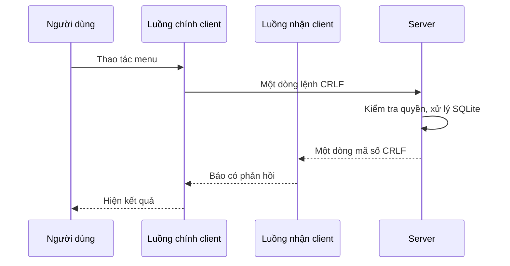
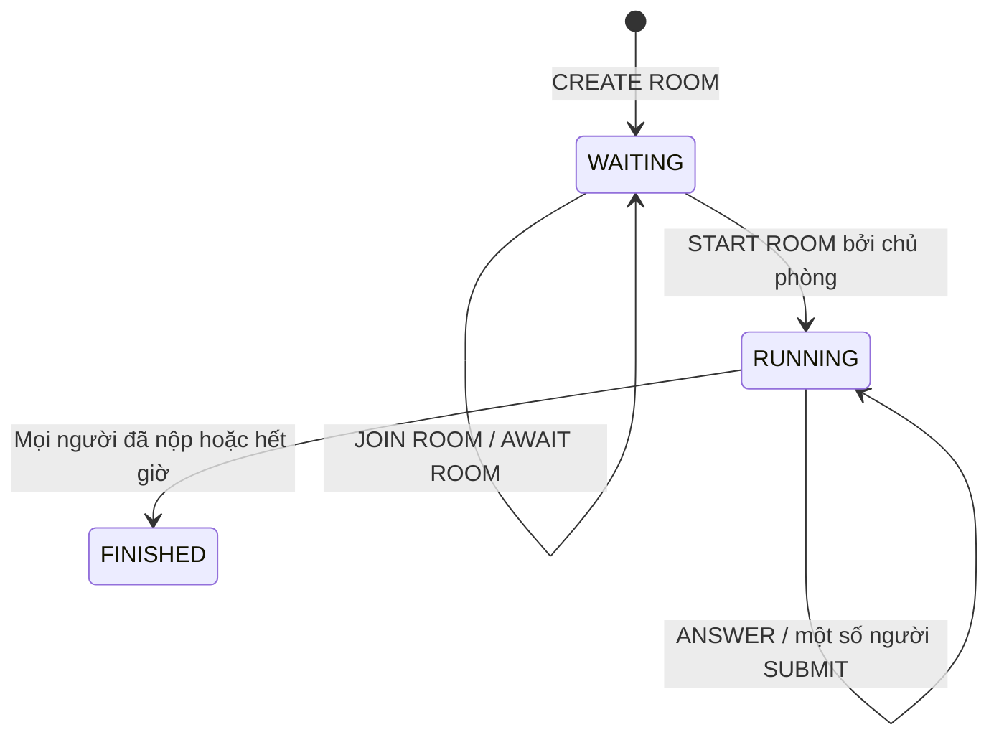

# Luồng hoạt động và vòng đời phiên — Online Test System

Tài liệu mô tả cách project hiện tại vận hành, từ khi server khởi động đến khi người dùng kết thúc phiên. Định dạng chính thức của lệnh và mã phản hồi nằm trong [protocol.md](protocol.md). Các ví dụ bên dưới là dữ liệu trên mạng của giao thức mới: văn bản UTF-8, dấu cách, mã số và kết thúc CRLF; không có tiền tố độ dài 4 byte.

## 1. Các thành phần tham gia

| Thành phần | Công việc |
|---|---|
| Client chủ phòng | Đăng nhập, tạo phòng, bắt đầu phòng, xem kết quả |
| Client người thi | Đăng nhập, vào phòng, chờ đề, trả lời, nộp bài |
| Client luyện tập | Tạo và làm bài cá nhân; có thể chính là một trong các client trên |
| Server | Kiểm tra phiên/quyền, chọn đề, quyết định giờ, lưu đáp án và chấm điểm |
| SQLite question.db | Lưu tài khoản, câu hỏi, phòng, bài làm, điểm và log |

Mọi tài khoản có cùng quyền cơ bản. Người tạo phòng là chủ phòng và chỉ được bắt đầu phòng của mình. Chủ phòng không tự động được ghi danh làm thí sinh. Phiên đăng nhập hiện tại gắn với socket và giữ trong bộ nhớ; tài khoản và bài làm được lưu lâu dài trong SQLite.

## 2. Khởi động server và database

1. Người vận hành biên dịch bằng build-windows.ps1 trên Windows hoặc make trên Linux.
2. Chạy server với cổng và đường dẫn database. Không truyền tham số thì dùng cổng 9000 và question.db trong thư mục làm việc hiện tại.
3. init_db mở file SQLite; nếu chưa có thì tạo file. CREATE TABLE IF NOT EXISTS tạo những bảng còn thiếu, không xóa các bản ghi đã có.
4. Bật khóa ngoại, đặt thời gian chờ khóa database 3 giây.
5. seed_questions nạp 20 câu tiếng Việt khi bảng questions rỗng, trừ khi EXAM_SKIP_SEED=1. Ngân hàng đã có dữ liệu không tự bị ghi đè.
6. Server tạo socket, bind địa chỉ IPv4/cổng, listen rồi accept kết nối.
7. Một luồng monitor_thread kiểm tra hết giờ khoảng mỗi 200 ms; mỗi kết nối được một client_thread xử lý.

Nếu mở/khởi tạo database thất bại, server báo Startup failed và không nhận client. Nếu cổng đã bị chiếm, server báo bind/listen failed. Chạy với database khác sẽ có tập tài khoản/phòng riêng; không tự đồng bộ các file .db.

```powershell
.\build-windows.ps1
.\server.exe 9000 question.db
```

## 3. Client kết nối và hai luồng làm việc

Client tạo TCP socket và connect tới server. Ví dụ trên cùng máy: client.exe 127.0.0.1 9000. Sau kết nối, client chưa được xác thực.

- Luồng chính hiện menu, đọc bàn phím và gọi request để gửi một yêu cầu rồi đợi phản hồi.
- receiver_thread liên tục gọi recv_frame để nhận dữ liệu. Phản hồi chính được chuyển cho luồng chính qua mutex và condition variable. Sự kiện mã 210 được hiển thị riêng.
- Server thêm cấu trúc Client vào active_clients; user_id ban đầu bằng 0. Server giới hạn registry ở 256 kết nối.



## 4. Đăng ký, đăng nhập và phiên

Mỗi dòng trong ví dụ được gửi với hai ký tự CR LF thực tế ở cuối. Chuỗi ký hiệu `\r\n` chỉ dùng để minh họa, không phải bốn chữ được gõ lên mạng.

```text
Client → Server: REGISTER alice pw123\r\n
Server → Client: 110\r\n
Client → Server: LOGIN alice pw123\r\n
Server → Client: 111\r\n
```

Đăng ký ghi username và mật khẩu băm PBKDF2 vào users. Đăng ký không tự đăng nhập. Tên đã có trong cùng database nhận 409 USER_EXISTS.

Đăng nhập đọc users, xác minh mật khẩu rồi kiểm tra tài khoản có phiên hoạt động không. Sai mật khẩu trả 401 CREDENTIALS; tài khoản đang đăng nhập nơi khác trả 409 ALREADY_LOGGED_IN. Thành công thì user_id, username được gắn với Client phía server; không phát token. Lệnh nghiệp vụ trước đăng nhập trả 401 LOGIN_REQUIRED.

```text
KẾT NỐI, CHƯA ĐĂNG NHẬP
  ├─ REGISTER thành công → vẫn CHƯA ĐĂNG NHẬP
  └─ LOGIN thành công → ĐÃ ĐĂNG NHẬP
ĐÃ ĐĂNG NHẬP ── LOGOUT → CHƯA ĐĂNG NHẬP
Bất kỳ trạng thái kết nối ── đóng socket → NGẮT KẾT NỐI
```

## 5. Luồng luyện tập cá nhân

Luyện tập không tạo phòng nhiều người và không có JOIN/AWAIT/START. PRACTICE là phạm vi của các hành động chung, không phải lệnh độc lập.

### 5.1. Tạo bài và bắt đầu tính giờ

Người dùng chọn menu 6 Practice, nhập số câu và thời lượng. Client gửi trên mạng:

```text
CREATE PRACTICE 2 180
131 "15" "end_at" "2"
```

Dòng đầu là yêu cầu; dòng sau là phản hồi minh họa. Khi chạy thật, end_at là số timestamp. Server kiểm tra count từ 1–50, duration từ 10–86400 giây và ngân hàng đủ câu. Server tạo practices cho tài khoản hiện tại, chọn cố định câu vào practice_questions, trả practice_id và end_at. Đồng hồ bắt đầu khi tạo bài, trước khi client lấy câu đầu tiên; thời gian tải đề cũng nằm trong thời lượng.

### 5.2. Lấy câu và trả lời

```text
QUESTIONS PRACTICE 15 1
132 "1" "2 + 3 bằng bao nhiêu?" "4" "5" "6" "7"
ANSWER PRACTICE 15 1 B
126
```

Server kiểm tra bài thuộc người đang đăng nhập, còn giờ, chưa có điểm và vị trí hợp lệ. Nội dung câu lấy từ questions qua practice_questions; lựa chọn ghi vào practice_answers. Không gửi correct cho client.

Lặp QUESTIONS/ANSWER cho các câu còn lại. Giao thức cho phép gửi lại ANSWER để thay lựa chọn cùng câu trước khi nộp/hết giờ. Tuy nhiên UI luyện tập hiện đi lần lượt, chưa có thao tác quay lại câu trước; nhấn Enter có thể bỏ qua câu. Client chuyển lựa chọn chữ thường thành chữ hoa trước khi gửi.

### 5.3. Nộp bài hoặc hết giờ

```text
SUBMIT PRACTICE 15
133 "1" "2"
```

Server so lựa chọn với đáp án đúng, lưu score và submitted_at trong practices. Nếu bài đã có điểm, SUBMIT/STATUS trả lại điểm đã lưu. Nếu người dùng bỏ qua câu, câu đó không được tính đúng.

Nếu không nộp, monitor_thread tự chấm bài hết hạn; không có sự kiện 210 riêng cho luyện tập. Client dùng STATUS PRACTICE để hỏi: bài còn chạy trả 134 "RUNNING" "end_at", có điểm trả 133 "correct" "total". UI thông thường yêu cầu nộp/lấy trạng thái sau khi đã đi qua các câu.

## 6. Luồng thi theo phòng

### 6.1. Chủ phòng tạo phòng

Sau đăng nhập, chủ phòng chọn menu 2 Create room:

```text
CREATE ROOM PhongA 2 300
120
```

Server kiểm tra tên phòng không trùng, tối đa 48 byte, ngân hàng đủ câu và số câu/thời lượng hợp lệ. Trong một giao dịch, server ghi rooms và room_questions. Bộ câu được chọn tại CREATE và không bốc lại mỗi lần nhận đề. Phòng ở WAITING; chưa bắt đầu đếm 300 giây.

### 6.2. Xem danh sách và tham gia

```text
LIST ROOMS
121 ROW "R" "PhongA" "WAITING" "2" "300" "teacher"
JOIN ROOM PhongA
122
```

LIST ROOMS lấy tối đa 100 phòng mới nhất. Mỗi ROW R ghi tên phòng, trạng thái, số câu, thời lượng và chủ phòng. Đây là danh sách phòng, không phải danh sách người online.

JOIN kiểm tra phòng còn WAITING và chưa đủ 32 người rồi ghi enrollments. Tham gia lại khi đã có tên trong phòng WAITING vẫn trả 122, không thêm trùng. JOIN sau khi phòng đã chạy/kết thúc trả 409 ROOM_NOT_WAITING.

### 6.3. Người thi chờ, chủ phòng bắt đầu

Sau JOIN, client tự gửi AWAIT ROOM PhongA. AWAIT là hành động; WAITING là trạng thái. Server giữ yêu cầu chờ tối đa khoảng 30 giây, kiểm tra mỗi 100 ms. Nếu phòng vẫn chờ, trả 124 và client gửi AWAIT lại.

Trên kết nối khác, chủ phòng chọn menu 4 Start room:

```text
START ROOM PhongA
123
```

Chỉ người tạo phòng được START; người khác nhận 403 FORBIDDEN. Phải có ít nhất một tài khoản đã JOIN, nếu chưa có trả 409 NO_PARTICIPANTS. Không phải chờ đủ 32 người. Server chuyển phòng WAITING → RUNNING, đặt start_at và end_at. Thời gian bắt đầu từ lúc này; mọi người có cùng hạn cuối.

Server trả 123 cho chủ phòng. Người thi đang AWAIT nhận 125 khi luồng chờ thấy phòng RUNNING; không có bảo đảm thứ tự tuyệt đối giữa phản hồi trên hai socket khác nhau.

### 6.4. Phát đề

```text
125 "PhongA" "end_at" "2" ROW "Q" "1" "2 + 3 bằng bao nhiêu?" "4" "5" "6" "7" "" ROW "Q" "2" "Một tuần có mấy ngày?" "5" "7" "6" "8" ""
```

Đây là một dòng duy nhất, có CRLF ở cuối. ROW đánh dấu bản ghi trong dòng. Mỗi Q chứa vị trí, câu hỏi, bốn lựa chọn và lựa chọn đã lưu của chính người thi. Trường cuối rỗng nếu chưa trả lời. Server không gửi ký tự đáp án đúng. Client phân tích và hiển thị toàn bộ đề.

QUESTIONS ROOM PhongA dùng để lấy lại đề/trạng thái ngay, không giữ yêu cầu lâu như AWAIT. WAITING trả 124, RUNNING trả 125, FINISHED trả 130 kèm điểm nếu đã có.

### 6.5. Trả lời và đổi lựa chọn

```text
ANSWER ROOM PhongA 1 B
126
ANSWER ROOM PhongA 1 A
126
```

Server kiểm tra người gửi là thành viên, phòng RUNNING, end_at chưa tới, chưa có kết quả và pos nằm trong đề. Lựa chọn được INSERT hoặc UPDATE vào exam_answers theo phòng/người/vị trí. Gửi lần sau thay lựa chọn lần trước; 126 chỉ xác nhận lưu, không công bố đúng/sai.

Client hỏi STATUS ROOM trong lúc làm bài. Nếu chưa nộp, nhận 128 "RUNNING" "end_at"; nếu đã có điểm, nhận 127 "correct" "total". Đồng hồ server quyết định cho nhận đáp án; hiển thị đếm ngược phía client chỉ để hỗ trợ người dùng.

### 6.6. Nộp sớm

Người thi chọn s và xác nhận y trong UI:

```text
SUBMIT ROOM PhongA
127 "1" "2"
```

room_score đếm các lựa chọn khớp questions.correct; submit_user lưu results với automatic=0 và log SUBMIT. Gửi SUBMIT lại trả điểm đã lưu; không tạo kết quả trùng. Người đã nộp không thể sửa đáp án, dù phòng còn thời gian. Phòng vẫn RUNNING nếu còn thành viên chưa nộp; nếu mọi người đã có kết quả, finish_room_if_done chuyển FINISHED ngay.

### 6.7. Hết giờ và sự kiện

monitor_thread hoặc bước kiểm tra trước khi xử lý lệnh gọi finish_expired. Server tìm phòng RUNNING với end_at đến hạn, chấm các thành viên chưa có kết quả, lưu automatic=1 rồi chuyển phòng FINISHED. Người đã nộp không bị chấm lại.

```text
Server → Client: 210 "PhongA" "1" "2"
```

210 là sự kiện chủ động cho người chưa nộp còn kết nối, có thể đến giữa yêu cầu và phản hồi chính. receiver_thread hiển thị thông báo và tiếp tục chờ phản hồi chính. Mất kết nối không bảo đảm nhận sự kiện, nhưng điểm đã lưu vẫn lấy lại được sau LOGIN.

### 6.8. Bảng điểm

```text
RESULTS ROOM PhongA
129 ROW "R" "alice" "1" "2" "0" ROW "R" "bob" "0" "2" "1"
```

Chỉ chủ phòng hoặc thành viên xem được, và chỉ khi FINISHED. Mỗi dòng dữ liệu logic gồm username, correct, total, automatic; automatic=0 nộp sớm, =1 tự chấm hết giờ. Các bản ghi sắp theo số đúng giảm dần rồi tên. Server đọc results, không nhận điểm tự khai từ client. Phòng chưa kết thúc trả 409 ROOM_NOT_FINISHED.



## 7. Đường đi của một thông điệp

1. Hàm giao diện trong client.c tạo chuỗi lệnh nội bộ.
2. request gọi send_frame trong net.c. Codec đổi tên lệnh nội bộ thành cú pháp chung có phạm vi, tách tham số bằng dấu cách và thêm CRLF.
3. send_all lặp đến khi gửi đủ chuỗi. TCP có thể chia nhỏ/gộp dữ liệu.
4. recv_frame phía server đọc đến CRLF, giới hạn độ dài, giải mã chuỗi sang dạng nội bộ; không đọc 4 byte độ dài như bản cũ.
5. client_thread gọi dispatch dưới db_mutex để kiểm tra và xử lý lệnh. Với AWAIT, thực hiện vòng chờ và nhả khóa giữa các lượt.
6. Server tạo phản hồi nội bộ; send_to_client dùng send_mutex ngăn phản hồi và sự kiện ghi chồng trên cùng socket. Codec đổi sang mã số, dấu cách, ROW và CRLF trên mạng.
7. receiver_thread phía client giải mã, chuyển phản hồi cho request hoặc hiển thị sự kiện 210.

Ký tự | và tên lệnh P... còn trong code là dạng nội bộ để tái sử dụng nghiệp vụ; không phải nội dung socket. Một phản hồi có nhiều ROW vẫn chỉ là một dòng giao thức. Bảng trên terminal được in thành các dòng/cột, tiêu đề và bản ghi dùng khoảng cách tab, không in dấu | làm vạch chia cột.

## 8. Ngắt kết nối, đăng xuất, khởi động lại

LOGOUT trả 112 và xóa phiên trên kết nối; tài khoản vẫn ở users. Thoát client đóng socket. Khi server phát hiện đóng kết nối, ghi log và bỏ Client khỏi registry. Trong AWAIT, peer_closed hỗ trợ phát hiện đóng kết nối sớm. Mất mạng không có tín hiệu đóng rõ ràng có thể không được phát hiện ngay; chưa có heartbeat/timeout nhận tổng quát.

Đáp án và điểm đã lưu không mất khi client ngắt kết nối. Đăng nhập lại bằng đúng database cho phép STATUS ROOM lấy điểm hoặc QUESTIONS ROOM lấy đề còn chạy. Giao thức hỗ trợ lấy lại đề, nhưng menu hiện chưa có mục khôi phục bài riêng; Join room không dùng được để vào lại phòng đã RUNNING. Luyện tập cũng cần biết practice_id để hỏi trạng thái qua giao thức; UI chưa có danh sách lịch sử bài cá nhân.

Khi server dừng, các phiên bộ nhớ mất. Sau khi server chạy lại, dữ liệu SQLite vẫn có; các bài quá hạn được xử lý khi luồng monitor hoạt động lại. Không có cơ chế tạm dừng đồng hồ trong thời gian server tắt. Dùng lại cùng file database để thấy lịch sử cũ.

## 9. Nơi lưu dữ liệu và nguồn xử lý

| Bảng | Thời điểm được dùng |
|---|---|
| users | REGISTER ghi tài khoản; LOGIN đọc xác thực |
| questions | Nạp câu mẫu, chọn đề, lấy nội dung, đối chiếu đáp án |
| rooms | CREATE tạo; START đặt giờ; hoàn tất cập nhật FINISHED |
| room_questions | Cố định bộ đề lúc tạo phòng |
| enrollments | Ghi thành viên khi JOIN |
| exam_answers | Lưu/thay lựa chọn khi ANSWER ROOM |
| results | Lưu điểm và cờ automatic khi nộp hoặc hết giờ |
| practices | Tạo bài cá nhân, hạn giờ và điểm |
| practice_questions | Bộ câu cố định của bài cá nhân |
| practice_answers | Lựa chọn bài cá nhân |
| logs | Hoạt động tài khoản, phòng, nộp bài, khởi động, ngắt kết nối |

| File/hàm | Công việc |
|---|---|
| server.c: init_db | Mở database, tạo bảng, nạp câu mẫu |
| server.c: dispatch | Xử lý hành động và quyền |
| server.c: exam_payload | Tạo dữ liệu đề phòng |
| server.c: room_score, submit_user | Chấm và lưu kết quả |
| server.c: finish_expired, monitor_thread | Tự chấm, kết thúc khi quá hạn |
| server.c: finish_room_if_done | Kết thúc sớm khi mọi người nộp |
| server.c: client_thread | Vòng nhận yêu cầu và quản lý kết nối |
| client.c: practice, join_room, exam_menu | Giao diện luyện tập, chờ phòng và làm bài |
| client.c: receiver_thread, request | Phối hợp gửi, nhận và sự kiện |
| net.c | Codec chuỗi, mã số, ROW, CRLF, gửi đủ dữ liệu |
| seed_questions.c | 20 câu tiếng Việt mẫu |

## 10. Lỗi và giới hạn cần giải thích

Mỗi lỗi nghiệp vụ gửi mã nhóm và lý do: 400 sai yêu cầu, 401 xác thực, 403 quyền, 404 không tìm thấy, 409 sai trạng thái/xung đột, 500 lỗi xử lý. Xem protocol.md cho danh sách cụ thể. Một số lỗi SQLite kế thừa có thể được gộp thành lỗi xung đột; không phải lỗi SQLite nào cũng trả 500 DB. Dòng hỏng hoặc kết nối đứt có thể đóng socket mà không có mã lỗi.

Chưa có TLS, giới hạn thử mật khẩu liên tục hoặc heartbeat. PBKDF2 bảo vệ mật khẩu lưu trong database; không che chữ khi gõ và không mã hóa mạng. UI không còn thêm câu hỏi/đổi mật khẩu. Một khóa database chung giúp tuần tự hóa truy cập nhưng có thể làm chậm nhiều yêu cầu đồng thời. Registry phiên chỉ dùng trong một server. Bộ client/server mới phải cùng dùng giao thức CRLF; bản cũ length-prefix không tương thích.

## 11. Kịch bản tự kiểm tra theo trình tự

1. Biên dịch và chạy server với question.db; mở hai client, đăng ký/đăng nhập hai tài khoản khác nhau.
2. Một client tạo bài luyện tập 2 câu/180 giây, trả lời và nộp; kiểm tra nhận điểm.
3. Chủ phòng tạo phòng 2 câu/180 giây; client còn lại JOIN và chờ.
4. Chủ phòng START; người thi thấy toàn bộ câu và bốn lựa chọn; trả lời, đổi một lựa chọn rồi nộp sớm.
5. Chủ phòng xem RESULTS sau khi phòng FINISHED; xác nhận automatic=0.
6. Tạo phòng mới 1 câu/20 giây, JOIN rồi START; không nộp và đợi sự kiện hết giờ; xem automatic=1.
7. Đăng xuất, đăng nhập lại; kiểm tra dữ liệu được giữ khi dùng cùng database.
8. Bộ tự động: python tests/test_integration.py. Test dùng database tạm, không xóa question.db thật.

## Tài khoản thống nhất và tương thích database

Ứng dụng đã bỏ vai trò admin/student và EXAM_ADMIN_CODE khỏi đăng ký, đăng nhập, menu và kiểm tra quyền. REGISTER chỉ nhận username password, LOGIN trả 111 không có tham số role. Quyền phụ thuộc người tạo phòng, thành viên phòng hoặc chủ bài cá nhân. Cột users.role được giữ như dữ liệu tương thích với database cũ; tài khoản mới ghi giá trị legacy student để đáp ứng ràng buộc cũ, không dùng cột này để phân quyền. Tài khoản admin cũ vẫn đăng nhập được như mọi tài khoản. Không xóa hoặc ghi đè question.db.
